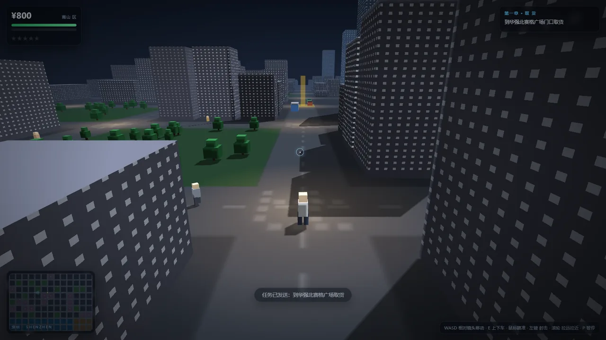
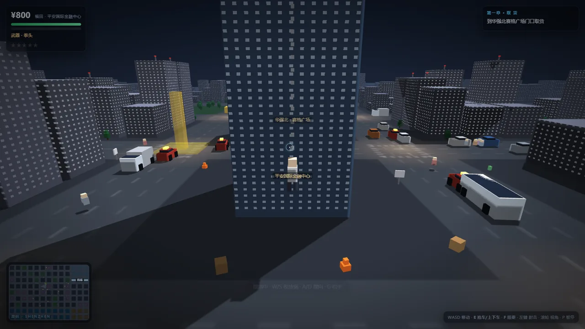
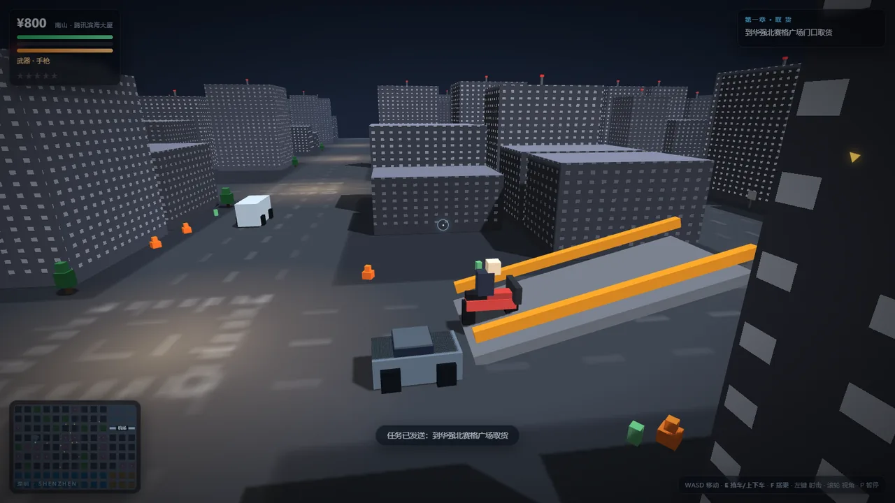
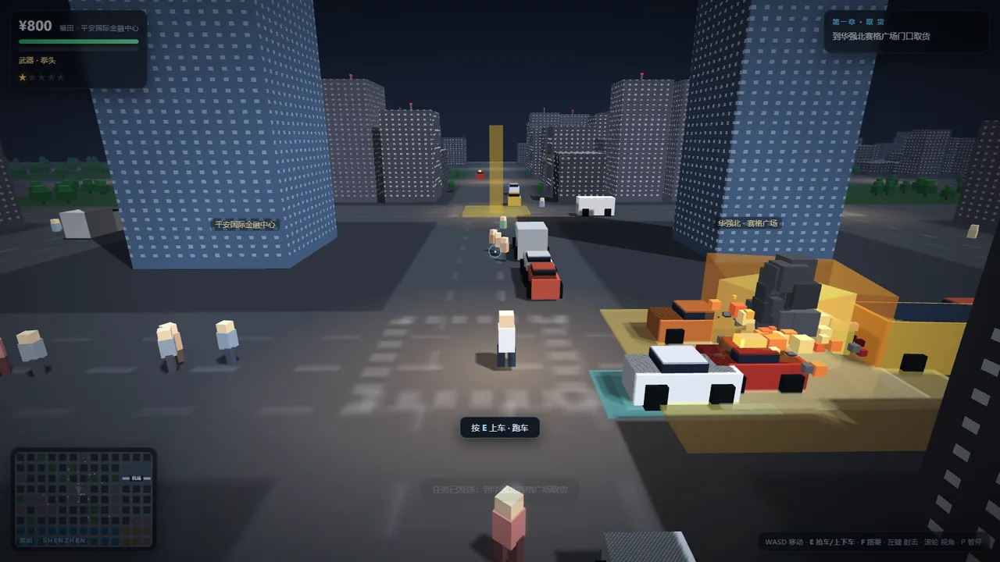
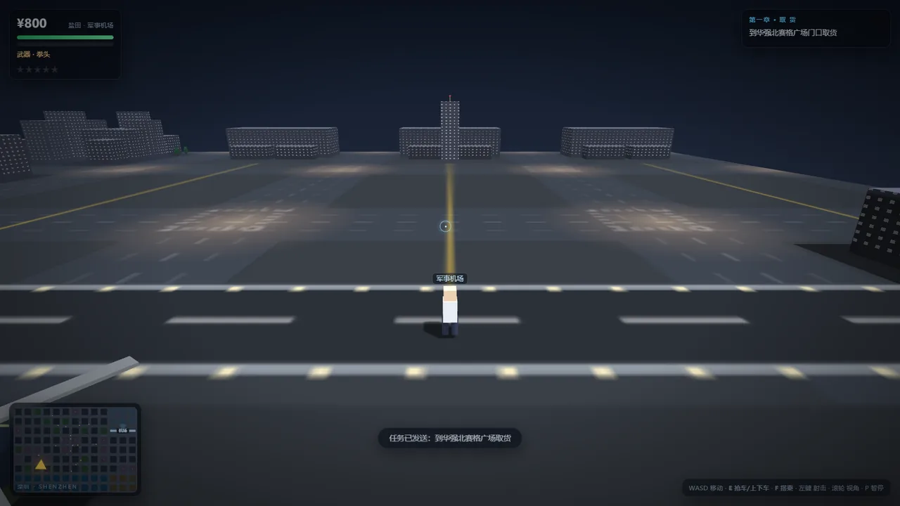
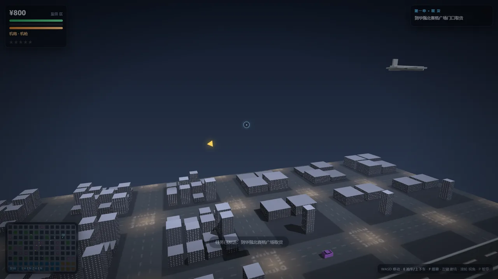
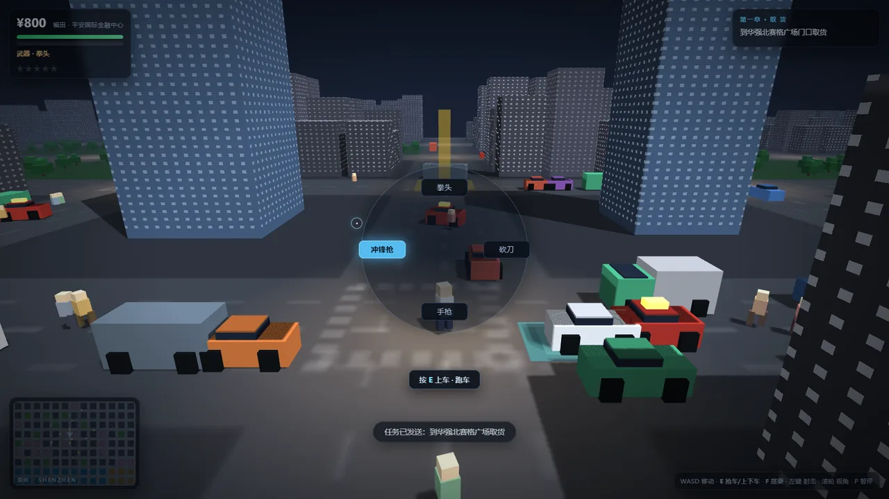
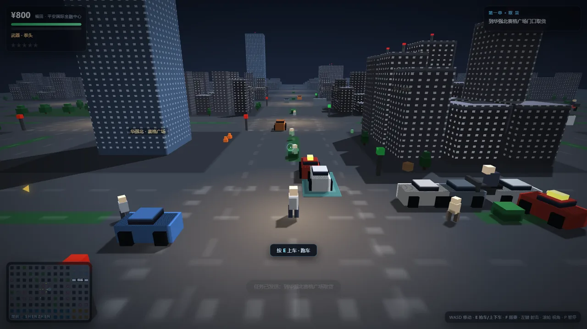
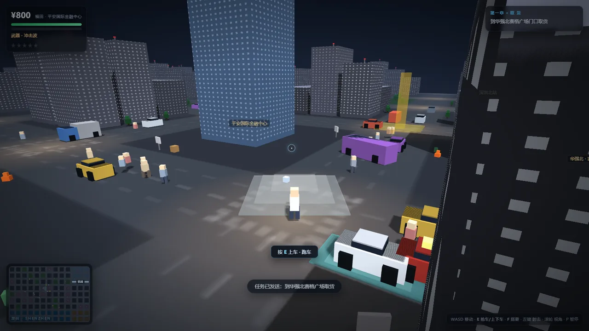
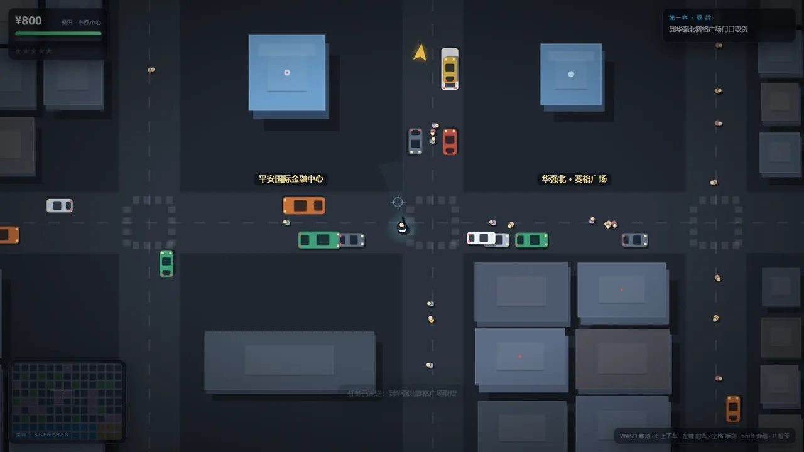

# Pengcheng Storm · Shenzhen Open World

**English** · [简体中文](README.md)

[](https://github.com/Kaiii521/shenzhen-gta/actions/workflows/test.yml)

**▶ Play in your browser: <https://kaiii521.github.io/shenzhen-gta/>**

A GTA-inspired **single-file browser game** set in a stylized Shenzhen, rebuilt from real landmarks. Two versions share the same city generation and gameplay code — only the renderer differs.

| File | Version | Notes |
|---|---|---|
| `shenzhen-gta-3d.html` | **3D third-person** (GTA 3 style) | Hand-written WebGL2, real 3D city · ~3200 lines |
| `shenzhen-gta.html` | **2D top-down** (GTA 1/2 style) | Canvas 2D, lightest · ~1900 lines |

To run locally: double-click either file and open it in Chrome / Edge. **No server, no build step, no dependencies.**

## Screenshots

| 3D streets | Grappling swing |
|---|---|
|  |  |

| Ramp jump | Missile explosion |
|---|---|
|  |  |

| Military airfield | High-altitude camera |
|---|---|
|  |  |

| Weapon wheel | Widened junction with traffic lights |
|---|---|
|  |  |

| Shockwave launcher | 2D version |
|---|---|
|  |  |

---

## Controls

| Key | Action |
|---|---|
| `W A S D` / arrows | Walk (camera-relative in 3D). In a vehicle: throttle / brake-reverse / steer |
| Mouse move | **True 3D aiming** — the cursor ray tests airborne targets first, then the ground plane, so you can shoot up at aircraft and down at the street |
| Left mouse | Fire (works while driving — drive-by) |
| `E` | **Carjack / enter**: take the wheel; press again to get out |
| `F` | **Ride along**: become a passenger (taxis drive themselves, buses follow a route) |
| `G` | **Grappling hook**: latch onto a building / car / pedestrian (3D) |
| `Shift` | Sprint |
| `Space` | Handbrake (drift at speed) |
| **Tab (hold)** | **Weapon wheel** — hold to open, flick the mouse toward a slot, release to switch |
| `1`–`5` | Quick switch: fists / machete / pistol / SMG / shockwave |
| Mouse wheel | 3D: zoom the camera |
| `P` / `Esc` | Pause |

### Carjacking (`E`)

Every vehicle within 140 units gets a cyan highlight ring and a prompt such as "press E to jack · sports car".

- Parked cars → simply get in.
- **Moving cars → carjack**: the driver is pulled out and runs away, wanted level +0.8 stars (stealing moving traffic is a crime, as in GTA).
- Press `E` again to get out — **the empty car pulls itself over to the curb**.
- Taxis and buses also accept `F`; the prompt lists both keys.

### Passenger rides (3D)

A red car with a yellow roof sign is a taxi; the big box is a bus. Walk within 130 units to see "press F to ride".

- **Taxi**: your destination is announced on pickup (current mission, otherwise a distant landmark), metered by distance. It drives the road network itself, stops at the destination, charges you and drops you off. `F` / `E` to leave early.
- **Bus**: follows a route, stopping ~2 s at each stop.
- As a passenger you **cannot steer**, but you **can shoot**.
- A wrecked vehicle or a 60-second timeout ends the ride.

---

## The city

13 × 9 blocks (~7.3 km × 5.0 km after compression). Blocks are separated by **260-unit wide** dual carriageways with a **drivable planted median**, plus crosswalks at every junction.

- **Nanshan** — tech park, Houhai, Shenzhen Bay Port, Shenzhen University
- **Futian** — CBD, Civic Center, Huaqiangbei, Lianhua Hill
- **Luohu** — Dongmen old street, KK100, Diwang Tower
- **Yantian** — Yantian Port, Dameisha

The 3D version **floats landmark names in the world** (within 2.4 km, hidden while flying high) and marks them on the minimap.

**15 recognizable landmarks** (the tall blue-glass towers in 3D): Ping An Finance Centre, KK100, Diwang Tower, Civic Center, China Resources "Spring Bamboo", Tencent Binhai Mansion, Window of the World, Shenzhen Bay Sports Center, Huaqiangbei SEG Plaza, Dongmen, Yantian Port, Dameisha, Shenzhen North Station, Shenzhen Bay Port, Shenzhen University.

The south side is Shenzhen Bay with a drivable **Shenzhen Bay Bridge**; elevated roads cross the water, but pedestrians can't swim.

The **military airfield** in the north-east occupies **9 blocks**: terminal + control tower to the north, hangars on both sides of a taxiway, and a **1656-unit runway** with apron to the south. Runway edge lights, taxiway markings and an "airport" minimap label included.

Aircraft **respawn automatically**: every 5 s a vacant apron slot is refilled (cap 10 aircraft).

Each district has its own facade tint; tall towers get antennas with red obstruction lights, and blocks are lined with street trees.

---

## Gameplay systems

- **Vehicles**: sedan / sports / van / truck / bus / taxi / **motorcycle**, each with its own top speed, mass and steering. Walls cost HP; zero HP explodes.
- **Aircraft**: helicopter / fighter / airliner. Helicopters lift vertically; the fighter must reach speed 130 before it climbs, and **tops out at 1300**. Hitting a building taller than your altitude explodes you; bailing out hurts. Airborne aircraft ignore ground vehicle collision entirely.
- **Real vehicle-vs-vehicle collisions**: mass-weighted separation, closing-speed damage, no clipping.
- **Bullets are blocked by buildings**; impacts throw sparks.
- **Taking hits in a car only damages the car** — the player is hurt when it explodes. The HUD shows an orange vehicle-durability bar.
- **Drive-by shooting**: bullets always fly to the crosshair regardless of the car's heading; spread grows with speed.
- **Traffic AI**: right-hand lane discipline, random turns at junctions, obstacle avoidance, **obeys traffic lights**, **brakes for pedestrians**.
- **Pedestrians**: wander, panic and flee at gunfire, die if hit and raise your wanted level.
- **Kills drop cash**: green money piles that you pick up by walking over them.
- **Weapons**: fists / machete / pistol / SMG / shockwave launcher, with melee range and cone checks.
- **Weapon wheel**: hold Tab, aim the mouse, release to equip.
- **Aircraft guns**: helicopters and fighters both carry **machine gun / missile**, switched on the same wheel. Missiles fly along the true 3D aim vector (with vertical velocity) all the way to the ground, with a 78-unit blast radius — and never detonate on their own aircraft.
- **Explosions**: a spinning, rising fireball, white-hot core, ground shock ring, debris, smoke, **camera shake**, and scorch marks that persist for 26 s.
- **3D ballistics**: every bullet carries height and vertical velocity, so shooting up and shooting down use the same physics.
- **Aerial camera**: the higher you fly, the further the camera pulls back (242 → ~600), the wider the FOV (62° → 74°) and the flatter the pitch; high-altitude aircraft leave a contrail.
- **Wanted level**: 0–5 stars. More stars bring more police cars that chase, ram and shoot. Busted = ¥500 fine; killed = respawn at hospital for ¥300.
- **Police helicopters**: one spawns at 4 stars, two at 5, hovering above you and firing down. Shoot them out of the sky with your own aircraft.
- **Mission chain** (4 chapters, auto-accepted, with an on-screen arrow and a golden light pillar in 3D):
  1. Pickup — Huaqiangbei → Nanshan tech park (¥1500)
  2. Shake them off — survive 45 s at high wanted level (¥2200)
  3. Bay run — Shenzhen Bay Bridge → Houhai → Civic Center (¥3500)
  4. Last job — steal a black sedan and deliver it to Yantian Port (¥6000)
- **HUD**: money, health/armour, wanted stars, current district and nearest landmark, city minimap, mission panel.

---

## How the 3D version works

No three.js — roughly 1000 lines of hand-written WebGL2:

- **Real-time shadows**: a dedicated 2048² depth FBO with an orthographic light matrix and 3×3 PCF in the main pass; buildings, cars and people cast shadows that follow the player.
- **Static city**: 500+ buildings, hundreds of trees and the planted medians are pre-baked into **one VBO and one draw call**. Windows are **generated procedurally in the fragment shader from world coordinates** — no textures, no memory.
- **Ground**: a single 2048px city texture painted from the same block data (roads, lane markings, crosswalks, medians, water, parks, the Bay Bridge, plus baked warm lamp pools at junctions) mapped onto one large plane.
- **Vehicle models**: per-type — sedan/sports, van, truck, bus, police car, motorcycle with rider, helicopter, fighter, airliner; the player's car has self-illuminated headlights.
- **Pedestrians**: torso, head and two swinging legs driven by the walk phase.
- **Camera**: third-person chase with eased yaw, plus **occlusion pull-in** that samples building heights along the view ray so the camera never ends up inside a wall.
- **Pitch support**: the model matrix takes a pitch angle (`m4modelP`), so ramps are a single tilted slab instead of stacked steps.
- **Mouse aiming**: the screen point is unprojected into a ray that tests airborne spheres first, then the ground plane.
- Lighting is one directional light + sky ambient + distance fog; damaged cars smoke.

## Grappling hook (3D)

Press `G` at any **building / car / pedestrian** within 470 units; mass decides who moves:

- **Buildings / cars**: the anchor sits at 85% of the building height (max 320) and the rope behaves as a **real pendulum** — gravity pulls you down, the rope-length constraint keeps you on a sphere, and you are fastest at the bottom of the arc. `W/S` reels the rope in/out, `A/D` steers, `G` releases with all your momentum.
- **Heavier than you** (cars): you get pulled toward it.
- **Lighter than you** (pedestrians): they get yanked to you.
- Falling less than 420 units costs no damage; only the excess hurts.

## World interaction (3D)

- **Street props**: 400+ cones, boxes, bottles and signboards with mass and friction — you shove them on foot, cars send them flying, explosions scatter them.
- **Shockwave launcher** (weapon 5): a ground-hugging ring that blows props away by mass, shoves cars sideways and sends pedestrians scattering.
- **Skid marks**: handbraking at speed leaves two tyre trails that fade over 9 s.
- **Ramps**: five in the city with orange rails — **both the player and AI traffic launch off them**. A clean landing costs nothing; flipping costs HP and yaws the car.
- **Traffic lights**: every junction has a signal (18 s east-west / north-south cycle) and traffic stops at the line.
- **Material feedback**: bullets on metal ring high, bullets on concrete thud.

## Audio

No audio assets at all — everything is synthesized live with WebAudio:

- **Engine**: two sawtooth oscillators through a low-pass filter, pitch and gain following speed
- **Skidding**: noise + band-pass while handbraking at speed
- **Siren**: alternating square-wave two-tone, volume by distance to the nearest police car
- **Gunshots / explosions / impacts / metal hits**: noise bursts with different filters and envelopes

The `AudioContext` is created on the first "enter city" click (browser autoplay policy); if creation fails the game degrades silently.

---

## Tests

The repo ships a harness that runs the whole game inside Node (DOM/Canvas stubs plus a fixed random seed, so results are reproducible):

```bash
node tests/run.js            # everything
node tests/run.js features   # feature cases only (19)
node tests/run.js smoke      # main flow: start → drive → shoot → wanted → 4 missions → respawn → busted → stress
```

- `tests/harness.js` — boots the game's `<script>` in a vm, exposes frame stepping, key and mouse input
- `tests/features.js` — 19 isolated cases, each with a fresh world
- `tests/smoke.js` — the full main-line sequence
- CI runs it on every push (see `.github/workflows/test.yml`)

## Known limitations

- The 3D version is **low-poly and blocky** — no textures, no skeletal animation.
- Neither version has saves, radio stations or cutscenes, and there is no touch control.
- All art is original; no Rockstar assets were used.

## Roadmap

Day/night cycle, skeletal animation, gang territories, weapon shops, AI races, touch controls, save system.

## License

MIT — see [LICENSE](LICENSE).
