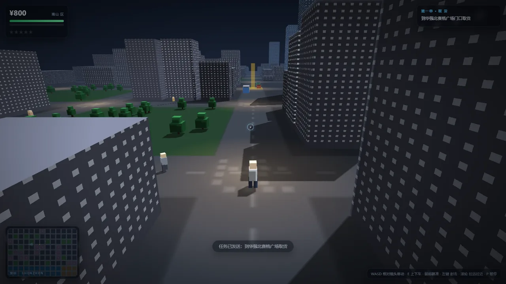
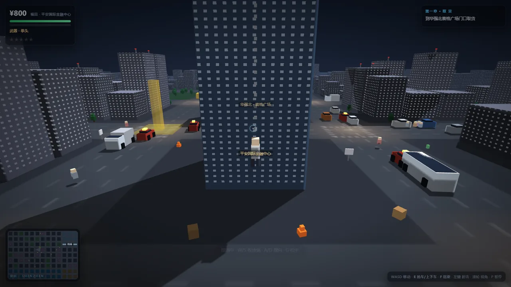
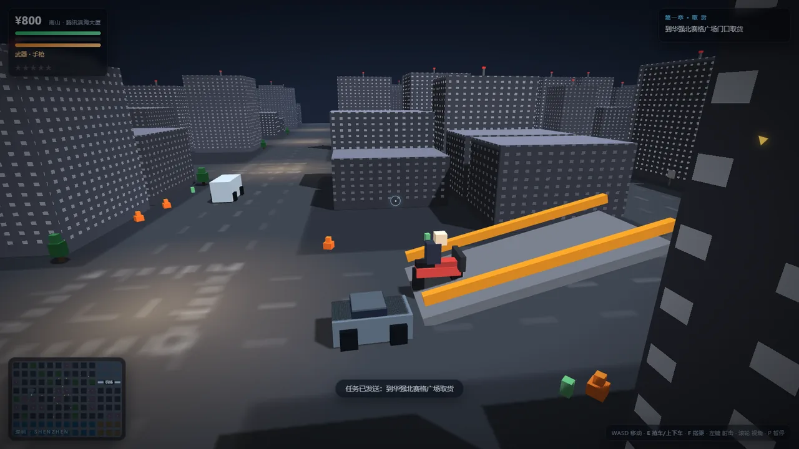
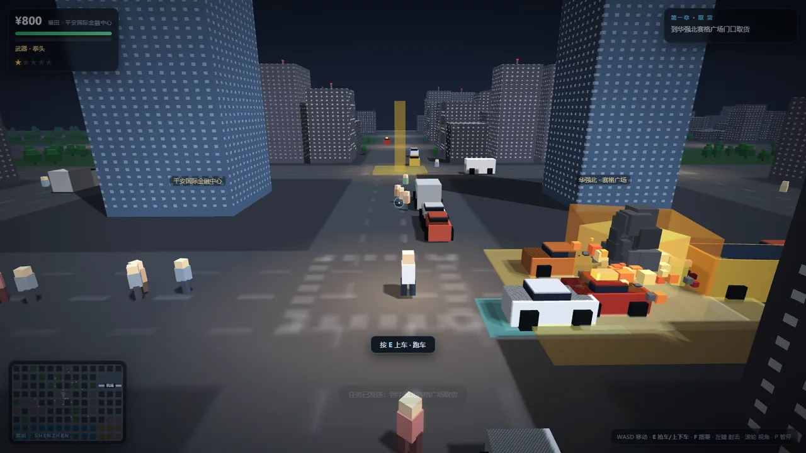
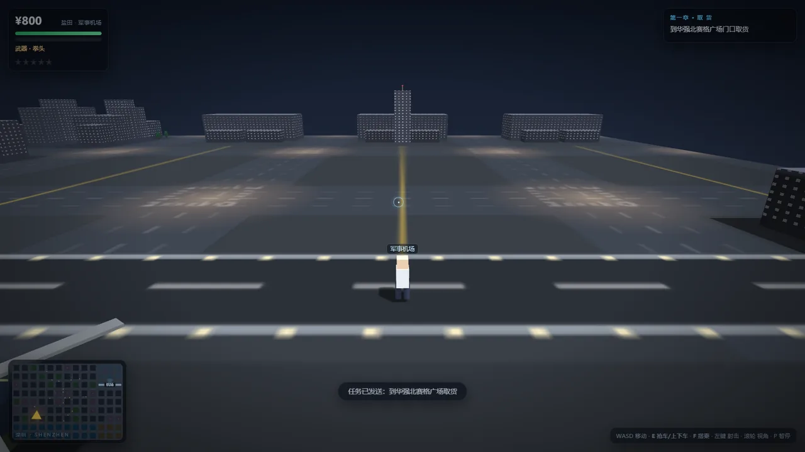
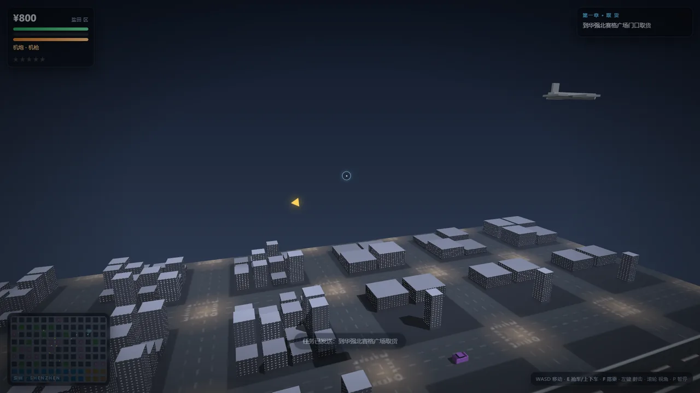
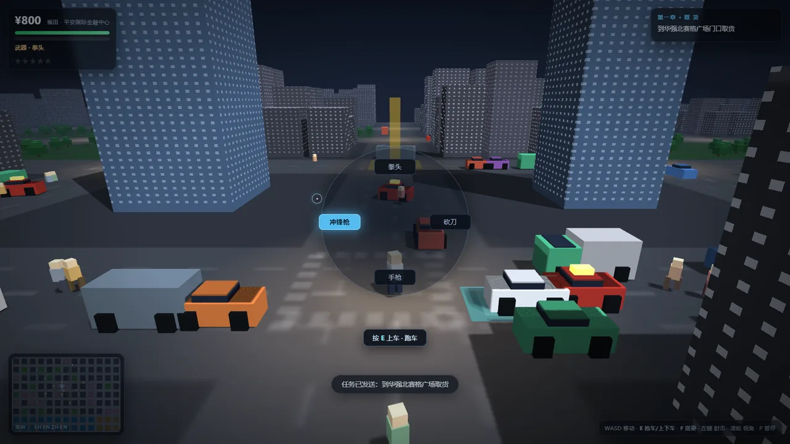
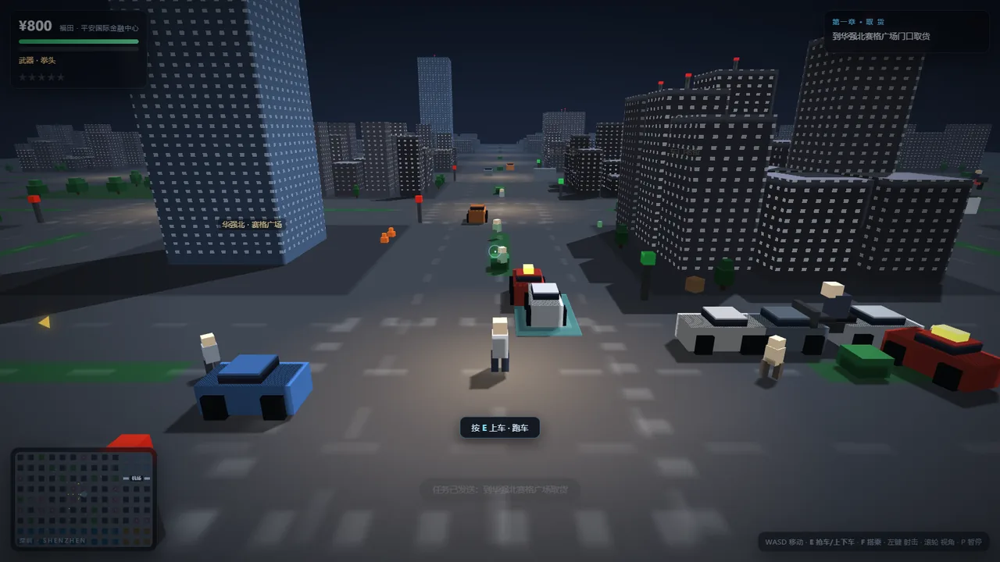
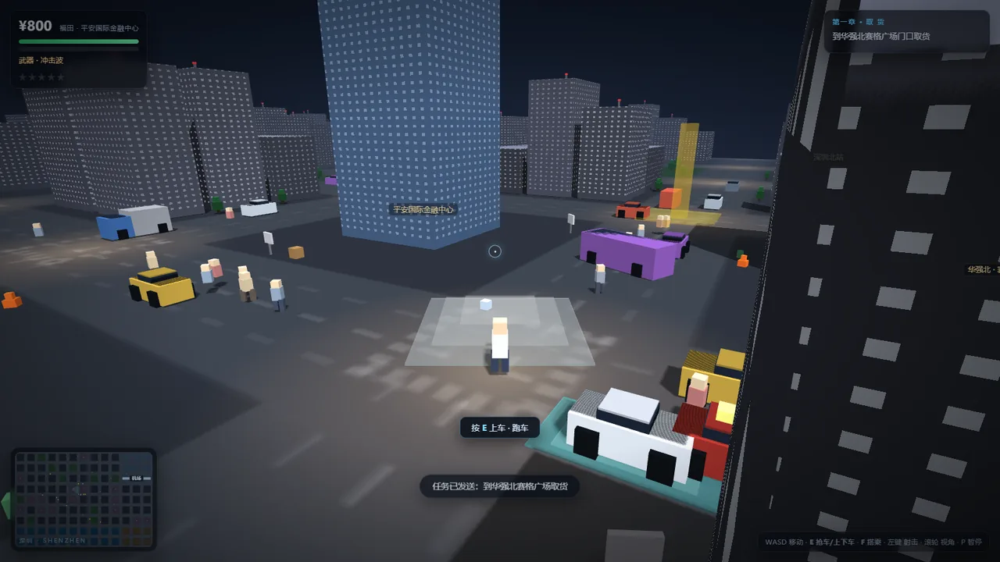
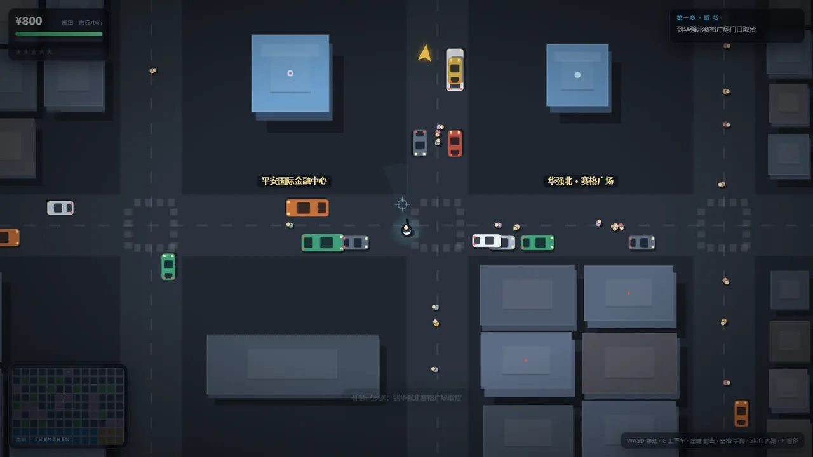

# 鹏城风云 · 深圳开放世界

[English](README.en.md) · **简体中文**

[](https://github.com/Kaiii521/shenzhen-gta/actions/workflows/test.yml)

**▶ 在线试玩：<https://kaiii521.github.io/shenzhen-gta/>**

仿 GTA 玩法的**单文件网页游戏**，地图按深圳真实地标重建。两个版本共用同一套城市生成与玩法逻辑，只有渲染层不同。

| 文件 | 版本 | 说明 |
|---|---|---|
| `shenzhen-gta-3d.html` | **3D 第三人称追尾**（GTA 3 视角） | 原生 WebGL2，真 3D 城市 · 约 3200 行 |
| `shenzhen-gta.html` | **2D 俯视**（GTA 1/2 视角） | Canvas 2D，最稳、最省资源 · 约 1900 行 |

打开方式：双击任一文件用 Chrome / Edge 打开即可。**不需要联网、不需要装任何东西**，也没有用任何第三方库。

## 截图

| 3D 版街道 | 抓钩摆荡 |
|---|---|
|  |  |

| 飞坡 | 导弹爆炸 |
|---|---|
|  |  |

| 军事机场 | 高空航拍 |
|---|---|
|  |  |

| 武器轮盘 | 拓宽后的路口 + 红绿灯 |
|---|---|
|  |  |

| 冲击波 | 2D 版 |
|---|---|
|  |  |

---

## 操作

| 按键 | 作用 |
|---|---|
| `W A S D` / 方向键 | 走路；3D 版是**相对镜头**方向移动。上车后是油门 / 刹车倒车 / 转向 |
| 鼠标移动 | **真 3D 瞄准**：光标射线先找空中目标、再和地面求交 —— 所以能抬头打飞机，也能在飞机上低头打地面 |
| 鼠标左键 | 开枪（**车里也能开**，就是 drive-by） |
| `E` | **抢车 / 上车**：自己开；车里再按一次下车 |
| `F` | **搭乘**：当乘客（出租车会自己开、公交按线路跑） |
| `G` | **抓钩**：对着楼 / 车 / 人射出，荡起来（3D 版） |
| `Shift` | 奔跑 |
| `空格` | 手刹（高速时用来漂移） |
| **Tab（按住）** | **武器轮盘**：按住弹出，鼠标甩向哪一格就选中哪个，松开即切换 |
| `1`–`5` | 快速换武器：拳头 / 砍刀 / 手枪 / 冲锋枪 / 冲击波 |
| 鼠标滚轮 | 3D 版：镜头拉远 / 拉近 |
| `P` / `Esc` | 暂停 |

### 抢车（`E`）

走到任何一辆车 140 米内，车底会亮起**青色高亮环**，屏幕底部浮出「按 E 抢车 · 跑车」这样的提示：

- 停着的车 → **上车**，直接接管。
- **开着走的车 → 抢车**：司机被拽下来、变成受惊路人四散跑开，通缉 +0.8 星（和 GTA 一样，抢路上的车是犯法的）。
- 上车后车归你控制，`E` 再按一次下车；**下车后车会自己滑到路边停好**。
- 出租车 / 公交同时支持 `F` 搭乘，提示条会同时列出两个键。

### 搭乘系统（3D 版）

在街上看到**红色带黄顶灯**的车就是出租车，**大方盒子**是公交车。走近（130 米内）屏幕会浮出「按 F 搭乘」：

- **出租车**：上车就报目的地（有任务就去任务点，没任务挑一个较远的地标），按里程打表。车会自己按路网开过去，**到站自动停车、扣车费、把你放下来**。中途 `F` / `E` 随时下车。
- **公交车**：沿路网逐站停靠（每站停 2 秒多），可以坐着兜风，`F` 随时下。
- 当乘客时你**不能接管方向**，但**可以开枪**。
- 车身被打坏、或 60 秒还没到，都会强制结束行程。

---

## 城市

13 × 9 个街区（等比压缩后的 7.3 km × 5.0 km），街区之间是 **260 宽**的双向四车道大路 + **中央绿化带**（可开过去），路口有斑马线。

- **南山**：科技园、后海、深圳湾口岸、深圳大学
- **福田**：CBD、市民中心、华强北、莲花山
- **罗湖**：东门老街、京基100、地王大厦
- **盐田**：盐田港、大梅沙

3D 版会在世界里**直接飘出地标名字**（走进 2.4 公里内才显示，上空飞行时自动隐藏），小地图上也会标出来。

**15 个可辨认的地标**（3D 版里是**蓝色玻璃幕墙 + 更高**的那几栋）：平安国际金融中心、京基100、地王大厦、市民中心、华润“春笋”、腾讯滨海大厦、世界之窗、深圳湾体育中心（春茧）、华强北·赛格广场、东门老街、盐田港、大梅沙、深圳北站、深圳湾口岸、深圳大学。

南边整片是深圳湾，有一条向南的**深圳湾大桥**可以开下去；跨海的路都是高架，车能过、人不能下水。

**军事机场**在盐田区东北角（地图右上），占 **9 个街区**，是一个完整的机场：北侧**航站楼 + 塔台**，中段**机库**（只在两侧，中间留滑行道），南侧 **1656 米跑道 + 停机坪**。跑道边灯、滑行道黄线、小地图上的「机场」标记都有。

飞机会**自动刷新**：每 5 秒检查一次停机位，被炸掉或开走的位置会补一架新的（总数上限 10 架）。

四个片区的楼色是有区别的：罗湖偏暖（老城）、福田偏冷白（CBD）、南山偏青蓝、盐田偏灰绿；高楼顶上有天线和红色航空障碍灯，街区边缘种了行道树。

---

## 玩法系统

- **载具**：轿车 / 跑车 / 面包车 / 卡车 / 巴士 / 出租车 / **摩托车**，极速、重量、转向各不相同；撞墙掉血，血量归零会炸。
- **飞行器**：直升机 / 战斗机 / 客机。直升机原地起降，战斗机要加速到 130 以上再拉起来，**最高能飞到 1300**；空中撞到比自己高的楼会直接炸，跳机会摔伤。空中不再受地面建筑 / 车流的 2D 碰撞干扰，不会卡住。
- **车与车会真的撞**：按体积分配推力（大车推小车），按接近速度算伤害和减速，不会穿模。
- **子弹会被建筑挡住**：沿弹道补采样，打到墙上有火花。
- **在车里中弹只掉车耐久**，车打爆了才伤到人；HUD 多一条橙色「车辆耐久」条。
- **车内射击（drive-by）**：子弹永远朝准星飞，跟车头朝向完全无关；车速越快散布越大。
- **交通 AI**：按右侧车道行驶，路口随机直行 / 左转 / 右转，会绕开建筑，**守红绿灯**，**会为行人急刹**。
- **行人**：平时闲逛，听到枪声四散逃跑；被车撞或中弹会死，并且**加通缉**。
- **打死人会掉钱**：地上会留下绿色钞票堆，走过去自动捡（小地图上是绿点）。
- **武器**：拳头 / 砍刀 / 手枪 / 冲锋枪 / 冲击波。近战有距离和扇形判定，砍刀一刀 60 伤害。
- **武器轮盘**：按住 Tab 出轮盘，鼠标指哪选哪，松手生效。
- **机炮**：直升机和战斗机都支持**机枪 / 导弹**双武器。导弹沿三维瞄准方向真飞（带垂直速度），能一路扎到地面；命中半径 78，不会在发射瞬间炸到自己。
- **爆炸特效**：旋转上升的火球 + 白热核心 + 贴地冲击环 + 碎片 + 黑烟 + **镜头震动** + 地面焦痕（留存 26 秒）。
- **弹道是三维的**：子弹带高度和垂直速度，从地面往上打、从天上往下打都是同一条物理。
- **航拍镜头**：飞得越高，镜头自动拉远（242 → ≈600）、视角变广（62° → 74°）、俯角变平；高空飞行时飞机会拉出白烟。
- **通缉**：0–5 星。星级越高警车来得越快越多，警车会追、会撞、会开枪。被抓 = 罚款 500，被打死 = 医院复活扣 300。
- **警用直升机**：通缉 4 星升空 1 架、5 星 2 架，盘旋在你上方扫射；你可以开直升机 / 战斗机把它打下来。击落后清空通缉。
- **任务链**（4 章，自动接取，屏幕上有黄色指引箭头 / 3D 版还有一道金色光柱）：
  1. 取货：华强北 → 南山科技园（¥1500）
  2. 甩尾：被通缉，撑过 45 秒（¥2200）
  3. 湾区飙车：深圳湾大桥 → 后海 → 市民中心（¥3500）
  4. 最后一单：抢一辆黑色轿车送到盐田港（¥6000）
- **HUD**：金钱、生命 / 护甲、通缉星、当前片区与最近地标、全城小地图、任务面板。

---

## 3D 版是怎么做的

没有用 three.js —— 从零写了一个约 1000 行的 WebGL2 渲染器：

- **实时阴影**：独立的深度 FBO（2048²）+ 正交光源矩阵，主通道用 3x3 PCF 采样；建筑、车、人都会在地上投影，阴影范围跟着玩家走。
- **静态城市**：把 500+ 栋楼 + 几百棵树 + 中央绿化带预烘焙成**一个 VBO、一次 draw call**。楼体是挤出的立方体，窗户在**片元着色器里用世界坐标程序化生成**（不占贴图、不占内存）。
- **地面**：用同一份街区数据在离屏 canvas 上画一张 2048px 的城市贴图（道路、车道线、斑马线、绿化带、水面、公园、跨海大桥，外加路口烘的暖色路灯光斑），贴到一张大平面上。
- **车辆模型**：按类型分——轿车 / 跑车、面包车、卡车、巴士、警车、**摩托车（带骑手）**、直升机 / 战斗机 / 客机；玩家车头有自发光车灯。
- **行人**：躯干 + 头 + 两条会摆动的腿，跟随走路相位。
- **相机**：第三人称追尾，朝向跟着车头或移动方向缓动；沿视线采样建筑高度做**遮挡收缩**，防止镜头穿墙进楼。
- **俯仰支持**：模型矩阵带 pitch（`m4modelP`），所以坡道是**一整块倾斜的板**，而不是叠出来的楼梯。
- **鼠标瞄准**：把屏幕坐标反投影成射线，先与空中目标的球体求交、再与地面 y=0 平面求交。
- 光照是单向光 + 天光 + 距离雾，受损车辆会冒烟。

## 抓钩（3D 版）

对着 470 米内的**楼 / 车 / 人**按 `G`，按重量判定谁被拉：

- **楼 / 车**：挂点高度 = 楼高 × 0.85（最高 320），绳子系上去后是**真钟摆** —— 重力把你往下带、绳长约束把你拽在球面上、最低点速度最快。`W/S` 收放绳、`A/D` 摆向，`G` 松手把速度甩出去。
- **车**（比你重）：把你拽向车，到位后挂在车边。
- **人**（比你轻）：把人直接拽过来，抓住即 KO 并掉钱。
- 低于 420 的落差**不扣血**，再高才按超出部分计算伤害。
- 绳索在 3D 里是真的一段段画出来的，会跟着镜头走。

## 环境互动（3D 版）

- **街道道具**：全城 400+ 个路锥 / 纸箱 / 瓶子 / 路牌，带质量和摩擦 —— 走过去会撞开，车压过去会飞，爆炸会成片掀翻。
- **冲击波发射器**（武器 5）：打出一圈贴地扩散的冲击波，把道具按质量吹飞、把车推歪、把行人掀得四散逃开。
- **手刹胎痕**：高速手刹会在路面上留下真实的双条轮胎印，9 秒淡出。
- **飞坡**：全城 5 条坡道（带橙色护栏），**玩家和 AI 车都能冲上去**；平稳落地不扣血，翻车才掉血 + 车头乱甩。
- **红绿灯**：每个路口都有信号灯（东西 / 南北 18 秒一换），车流遇红灯会停在停止线前。
- **材质反馈**：子弹打金属（车身）是高频金属声，打墙是闷响。

## 音效

没有任何音频素材，全部用 WebAudio 现场合成：

- **引擎声**：两个锯齿波 → 低通滤波，频率和音量跟着车速走
- **打滑**：噪声 + 带通，手刹且车速高时出现
- **警笛**：方波双音交替，音量按最近警车的距离衰减
- **枪声 / 爆炸 / 中弹 / 金属撞击**：噪声脉冲 + 不同滤波与包络

首次点击「进入城市」时才创建 AudioContext（符合浏览器自动播放策略），创建失败会静默降级，不影响游戏。

---

## 测试

仓库带一套可以在 Node 里跑整局游戏的测试（DOM / Canvas 桩件 + 固定随机种子，所以每次结果一致）：

```bash
node tests/run.js            # 全部
node tests/run.js features   # 只跑功能用例（19 项）
node tests/run.js smoke      # 只跑主线流程（开局→驾驶→射击→通缉→四章任务→复活→被捕→压测）
```

- `tests/harness.js` —— 桩件层：把 `<script>` 里的游戏跑进 vm，提供按帧推进、按键、鼠标接口
- `tests/features.js` —— 19 个独立用例，每个一份全新世界
- `tests/smoke.js` —— 主线流程串联
- CI：每次 push 自动跑（见 `.github/workflows/test.yml`）

## 已知边界

- 3D 版是**低多边形方块风格**，没有真实贴图、没有骨骼动画。
- 两版都**没有存档、没有电台、没有剧情过场**，也没做手机触屏操作。
- 用的是原创美术，没有取用任何 Rockstar 的素材。

## 想继续加的话

昼夜循环、真正的骨骼动画、帮派地盘争夺、商店买枪、AI 竞速赛、手机触屏适配、存档系统。

## 许可

MIT，见 [LICENSE](LICENSE)。
